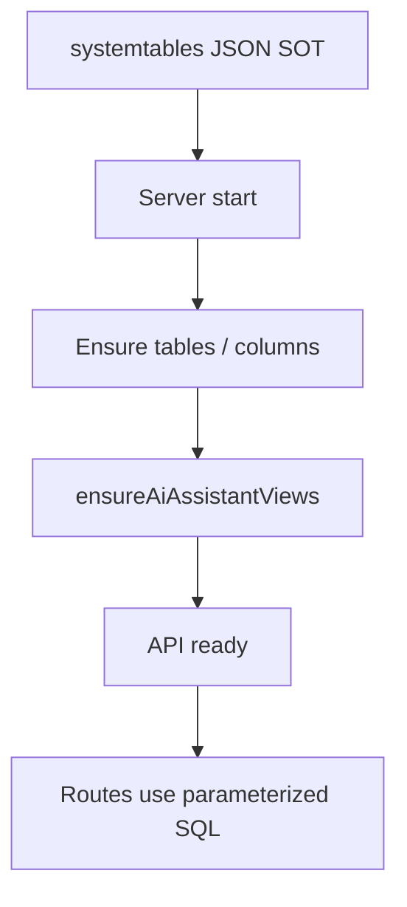

# Database schema — complete guide

**Audience:** Operator, contributor  
**Access:** Repo path `server/database/structure/systemtables/*.json`; applied on server startup  
**Requires:** Working `DB_*` connection (`mysql` or `mssql`)  
**When disabled / missing:** If the API cannot reach the DB, the app will not become ready — fix env before chasing “missing tables” in the UI.

Table and column definitions are JSON files. The server builds/migrates schema from that structure on startup. Prefer JSON edits over hand-written column migration scripts.

## 1 — Source of truth

| Item | Location / rule |
|------|-----------------|
| Schema SOT | `server/database/structure/systemtables/*.json` |
| Provider switch | `DB_PROVIDER=mysql` or `mssql` via `server/config/database.ts` |
| AI views | Created/ensured on start (`ensureAiAssistantViews`) |
| Manual column scripts | **Do not** add for normal field adds — edit JSON |

## 2 — Operator rules

1. Do not manually alter production columns out of band without updating the JSON SOT and coordinating app versions.
2. Backup before upgrades that may add columns — [[06-install-and-ops/deploy-checklist]].
3. Fresh DB + no admin → [[06-install-and-ops/install-wizard]] after schema bootstrap.
4. Role permission seeds and similar defaults are applied on first start as documented in `ROLE_PERMISSIONS.md` / FEATURES.

## 3 — Developer rules (portable SQL)

| Do | Don't |
|----|-------|
| `pool.execute(sql, [params])` from `server/config/database.ts` | String-concatenate user input into SQL |
| Import `RowDataPacket` / `ResultSetHeader` from the shared config | Import `mysql2` / `mssql` in route files |
| Prefer `CURRENT_TIMESTAMP` in new/edited SQL | Rely on `NOW()` in new portable code without care |
| Branch or assemble in TypeScript when dialects differ | Use MySQL-only helpers (`FIELD`, `GROUP_CONCAT`, `JSON_ARRAYAGG`) blindly |

## 4 — Backup / restore mindset

- **MySQL Compose:** `mysqldump` / restore examples in README and [[06-install-and-ops/docker-and-health]].
- **MSSQL:** use `BACKUP DATABASE` / `RESTORE DATABASE` with your SQL Server tooling.
- Schema JSON in git is not a substitute for a database backup.

> **SCREENSHOT** — Optional: capture a few `systemtables` JSON filenames in the repo (no data).
> File to add: `media/docs-ops-schema-json.png`

## Tips and mistakes

- “Table missing” after a partial deploy usually means the new image never booted successfully — check logs under `/app/logs`.
- AI assistant analytics need the ensured views; a failed start can leave the widget erroring even when the flag is on.
- Redis never owns schema — cache only.

## Related

- [[06-install-and-ops/install-wizard]]
- [[06-install-and-ops/local-development]]
- [[06-install-and-ops/environment-variables]]
- [[08-ai-assistant/admin-configuration]]
