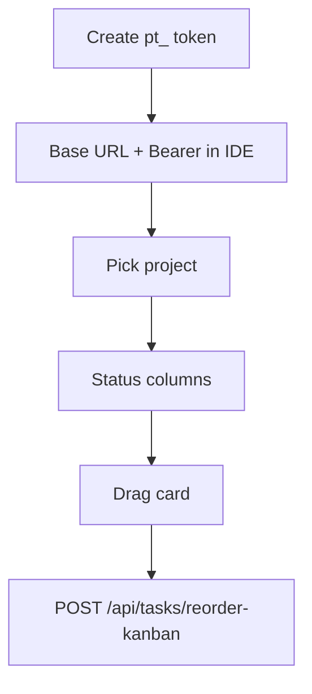

# IDE extensions (project Kanban) — complete guide

**Audience:** End user  
**Access:** IDE plugin + Myelin Profile → API Tokens  
**Requires:** Personal `pt_` API token + reachable Myelin HTTP/HTTPS base URL  
**When disabled / missing:** Extension shows auth/connection errors — there is no “IDE” Features flag.

Side-panel **project Kanban** inside VS Code / Cursor, JetBrains Rider, and Visual Studio 2022. Drag cards to change status via the same reorder API as the web board.

## 1 — Supported IDEs

| IDE | Package location (repo) |
|-----|-------------------------|
| VS Code / Cursor | `extras/ide-extensions/vscode` |
| JetBrains Rider | `extras/ide-extensions/rider` |
| Visual Studio 2022 | `extras/ide-extensions/visualstudio` |

Shared board UI: `extras/ide-extensions/shared-kanban`. Operator docs: `extras/ide-extensions/README.md` + `CONTRACT.md`.

### Operator builds (Woodpecker / Docker)

Tag builds bake **VS Code/Cursor** (`.vsix`) and **Rider** (`.zip`) into `extras/release` via the Dockerfile `ide-builder` stage (also `pnpm run companions:build` locally). **Visual Studio** still requires MSBuild on Windows — place that `.vsix` under `extras/release` in the image build context if you distribute it.

## 2 — Setup

1. In Myelin: **Profile → API Tokens** → create token → copy `pt_...` **once**.
2. Install the extension/plugin from Downloads or the package your operator provides.
3. Set **Base URL** + **Bearer token** in extension settings.
4. Pick a project; confirm columns load (org task status values).
5. Drag a card between columns to change status / order.

| API used (conceptual) | Purpose |
|-----------------------|---------|
| `GET /api/projects` | Project list |
| `GET /api/tasks/project/{id}` | Board tasks |
| `GET /api/status-values/task/{orgId}` | Columns |
| `POST /api/tasks/reorder-kanban` | Drag-and-drop persist |

> **SCREENSHOT** — Capture Kanban columns inside the IDE (redact token fields).
> File to add: `media/docs-companion-ide-kanban.png`

## 3 — Extra actions

- **Send to AI Chat…** on cards (Cursor uses the active chat; Rider/VS may copy to clipboard).
- Deep links to the web app remain available for full task detail when needed.

## 4 — Security hygiene

1. Treat `pt_` like a password — do not commit it to git or Synapse notes.
2. **Deactivate** or **Delete** tokens you no longer need (Profile; admins can revoke any under Administration → API Tokens).
3. Tokens authenticate as **you** with your effective permissions.

## Tips and mistakes

- **Self-signed HTTPS is not supported in v1** — use a trusted cert or HTTP only in controlled lab networks.
- Empty board: wrong project, expired token, or base URL typo (include scheme, no trailing junk).
- IDE Kanban is your project board, not the Dashboard personal assigned-only board.

## Done when

- Project list loads; drag updates status; web Kanban reflects the same order/status after refresh.

## Related

- [[07-companions/desktop-app]]
- [[07-companions/tampermonkey]]
- [[03-modules/projects-and-tasks]]
- [[04-workflows/task-first-delivery]]
