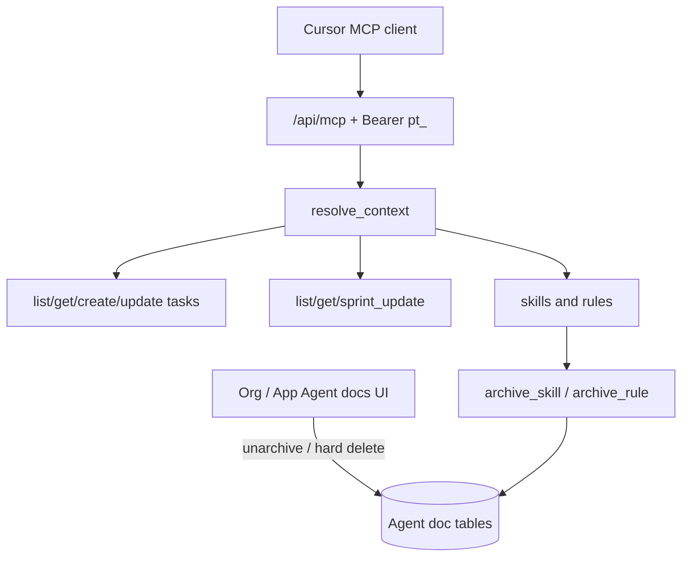

# Remote MCP (Cursor / agents) — complete guide

**Audience:** Developers using Cursor (or other MCP clients), managers who own Agent docs  
**Access:** MCP URL `{your-myelin-origin}/api/mcp` + Profile **API token** (`pt_…`)  
**Requires:** Internal user (not customer portal). Writes need Profile → **Allow MCP task writes** and client `allowWrite: true`. Agent-doc mutations also need manage org/app permissions.  
**When missing:** 403 for portal users; writes fail until both write gates are on.


Myelin exposes a **Streamable HTTP** MCP server so agents can resolve repo → application/project scope, read/write tasks and sprints, and manage agent skills/rules.



## 1 — Connect Cursor

1. Create a personal **`pt_`** token under **Profile → API Tokens**.
2. Add a server in `.cursor/mcp.json` or `~/.cursor/mcp.json` (prefer `${env:…}` for secrets):

```json
{
  "mcpServers": {
    "myelin": {
      "url": "https://YOUR-MYELIN-HOST/api/mcp",
      "headers": { "Authorization": "Bearer ${env:MYELIN_API_TOKEN}" }
    },
    "myelin-local": {
      "url": "http://localhost:3000/api/mcp",
      "headers": { "Authorization": "Bearer ${env:MYELIN_API_TOKEN_DEV}" }
    }
  }
}
```

3. Optional repo file `myelin.mcp.json` (`projectIds`, `strict`, `allowWrite`) — **no secrets**. Pass those fields (and `repositoryUrl` from `git remote`) on every tool call.
4. Reload MCP. If new tools do not appear, rename the server key to bust the tools cache.

Templates: `docs/mcp/cursor.mcp.json.example`, walkthrough `docs/mcp/CURSOR_RULE_MYELIN_MCP.md`.

## 2 — Profile write toggle

1. Open **My Profile** near API Tokens.
2. Enable **Allow MCP task writes** (`McpWritesEnabled`) when you want the agent to mutate tasks, sprints, or agent docs.
3. Keep `allowWrite: false` in `myelin.mcp.json` for read-only agent sessions.

## 3 — Agent docs (skills & rules)

| Where | Scope |
|-------|--------|
| Organization → **Agent docs** | Org-wide skills/rules (merged first for MCP) |
| Application → **Agent docs** | App-specific (merged after org) |

**UI:** create, edit, **archive**, **unarchive**, permanent **delete**.  
**MCP:** `list_*` / `get_*` / `create_*` / `update_*` / `archive_*`. Archived rows (`IsArchived = 1`) are **not** returned by MCP. MCP never hard-deletes.

Create via MCP with exactly one of `organizationId` or `applicationId` (must be in resolved scope). Pass `owner=organization|application` on update/archive if numeric ids collide across tables.

## 4 — Tasks & sprints (summary)

| Tool | Notes |
|------|--------|
| `resolve_context` | Matched apps, effective projects, write flags |
| `list_project_meta` | Status / priority / type catalogs before create |
| `list_my_tasks` / `get_task` | Assignee-scoped; includes description + sprint |
| `create_task` / `update_task` | Dual-gated; create assigns to self; optional `sprintId`, `unscheduledWork` |
| `list_sprints` / `get_sprint` / `sprint_update` | Sprint read + dual-gated update |

No task delete / reassign-to-others via MCP in v1.

## Tips

- Test new MCP tools on **myelin-local** before production.
- Never commit raw `pt_` tokens; use env substitution in mcp.json.
- Truth source: `docs/FEATURES.md` §21c.

## Related

- [[02-settings/profile]]
- [[07-companions/ide-extensions]]
- [[03-modules/applications-and-releases]]
- [[02-settings/organization-settings]]
