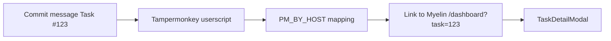

# Tampermonkey: Task # links — complete guide

**Audience:** End user  
**Access:** Browser Tampermonkey + Myelin userscript  
**Requires:** Tampermonkey (or compatible); userscript from Downloads or `extras/scripts/tampermonkey/`  
**When disabled / missing:** Commit pages show plain text — not a Myelin Features flag.

On GitHub / Bitbucket / Gitea commit pages, turn `Task #N` into links that open Myelin `/dashboard?task=N` (task detail modal).

## 1 — Install

1. Install **Tampermonkey** in your browser.
2. Install the Myelin userscript:
   - From the in-app **Downloads** catalog (`.user.js` URL), or
   - From the repo/image path `extras/scripts/tampermonkey/pm-task-commit-links.user.js` (name may match the shipped file).
3. Enable the script for your git hosts.

## 2 — Configure host → Myelin URL

1. Open the script settings / Tampermonkey menu override.
2. Map each git host to the correct Myelin base URL in `PM_BY_HOST` (or the menu override your build documents).
3. Example shape (illustrative):

| Git host | Myelin base URL |
|----------|-----------------|
| `github.com` | `https://myelin.example.com` |
| `gitea.example.com` | `https://myelin.example.com` |

4. Save and reload a commit page.

## 3 — Verify

1. Open a commit whose message contains `Task #123` (use a real id you can access).
2. Confirm `#123` (or the full `Task #123` token) is hyperlinked.
3. Click → Myelin opens Dashboard and the **task detail modal** for that id (`?task=` or `?taskId=`).

> **SCREENSHOT** — Capture a commit message where Task #N is hyperlinked.
> File to add: `media/docs-companion-tampermonkey.png`

## Tips and mistakes

- Wrong `PM_BY_HOST` entry sends you to the wrong Myelin instance.
- You still need permission to view the task — a 403/empty modal is an access issue, not a script bug.
- Script ships in the Docker image under `extras/scripts/tampermonkey` for Downloads exposure.

## Done when

- `Task #N` links resolve to the correct Myelin task modal from your git host.

## Related

- [[03-modules/dashboard]]
- [[07-companions/ide-extensions]]
- [[06-install-and-ops/docker-and-health]]
