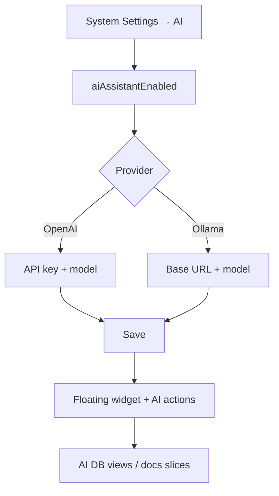

# AI assistant — admin configuration — complete guide

**Audience:** Admin  
**Access:** Administration → System Settings → **AI**  
**Requires:** `isAdmin`  
**When disabled / missing:** Widget and AI actions stay hidden until `aiAssistantEnabled` is on **and** a provider is configured.

Configure the optional SQL-backed AI assistant (OpenAI or Ollama). The same provider powers translate/summarize on tasks and AI-assisted patch-notes improvement. Database views are ensured on server start (`ensureAiAssistantViews`).

## 1 — Enable and choose provider

1. Sign in as admin.
2. Open **Administration → System Settings → AI**.
3. Enable **AI assistant** (`aiAssistantEnabled`).
4. Choose provider:

| Provider | Configure |
|----------|-----------|
| **OpenAI** | API key + model name |
| **Ollama** | Base URL + model (OpenAI-compatible `/v1/chat/completions`) |

5. **Save**.
6. Open the floating widget and ask a simple Analytics question to verify.
7. Confirm Docs mode answers a module question (e.g. Planning).

> **SCREENSHOT** — Capture AI tab with provider dropdown (redact keys).
> File to add: `media/docs-ai-admin-settings.png`

## 2 — What the assistant can see

| Mode | Context |
|------|---------|
| **Analytics** | Org/project/task/time (and related) via AI backend views |
| **Docs** | Curated in-app documentation slices (keyword-selected, not the full manual dump) |

Access rules:

- Widget requires global enable + working provider.
- Analytics answers still enforce report/visibility constraints.
- Budget insights stay hidden when `CanViewBudgetInfo` is denied.
- Responses are English-only by assistant policy.

## 3 — Security and ops notes

- Store keys in Admin settings (encrypted at rest with `ENCRYPTION_KEY` / `JWT_SECRET` fallback) — **never** paste keys into Synapse notes.
- Ollama must be reachable from the **Myelin server**, not only from the admin’s laptop browser.
- AI views depend on successful schema/start hooks — [[06-install-and-ops/schema]].
- Turning the flag off hides the widget even if keys remain stored.

## 4 — Related product surfaces

- Task translate / summarize actions (when offered in UI).
- Application release patch-notes AI improvement — [[04-workflows/release-readiness]].
- End-user usage: [[08-ai-assistant/widget-usage]].
- Break/fix matrix: [[08-ai-assistant/troubleshooting]].

## Tips and mistakes

- Enabling the flag without a provider looks like a “broken widget”.
- `frontpageEnabled` and other Features checkboxes do not control AI — only the AI tab master switch.
- Large local models on small hosts → timeouts; try a smaller Ollama model.

## Done when

- Flag on, provider saved, test question returns a sensible answer in both modes for an entitled user.

## Related

- [[02-settings/feature-toggles-overview]]
- [[08-ai-assistant/widget-usage]]
- [[08-ai-assistant/troubleshooting]]
- [[05-reference/permissions-matrix]]
