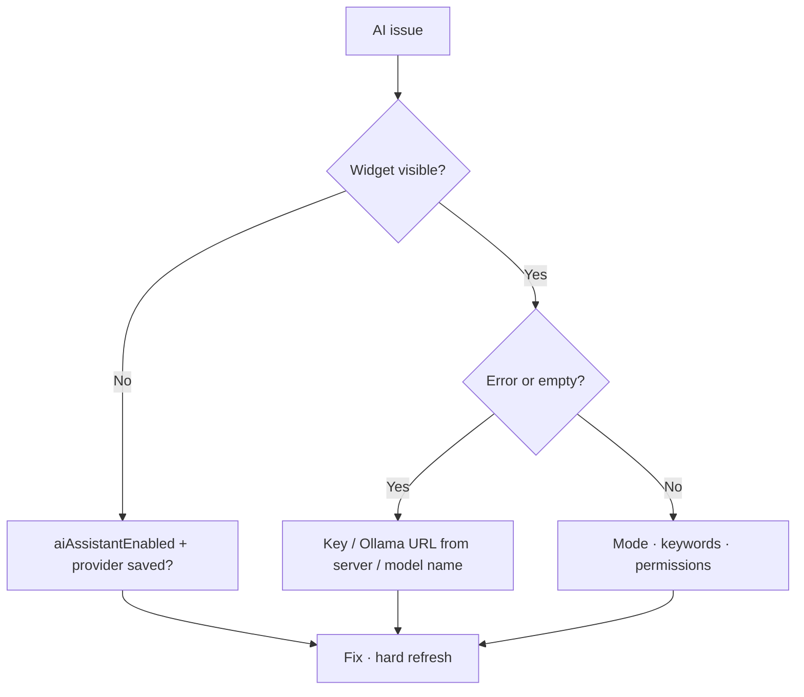

# AI assistant — troubleshooting — complete guide

**Audience:** Admin, End user  
**Access:** System Settings → AI; floating widget  
**Requires:** Ability to see whether `aiAssistantEnabled` and provider fields are set (admin)  
**When disabled / missing:** Treat “no widget” as configuration until proven otherwise.

Diagnose missing widget, empty answers, permission omissions, and slow Ollama hosts.

## 1 — Symptom table

| Issue | Fix |
|-------|-----|
| No widget | Enable AI feature + configure OpenAI or Ollama; save; hard refresh |
| Empty / error answers | Check API key, Ollama URL **reachability from the Myelin server**, model name |
| Timeouts / very slow | Smaller Ollama model; host CPU/RAM; network to Ollama |
| “No budget” style omissions | User lacks `CanViewBudgetInfo` — **expected** |
| Docs mode irrelevant | Rephrase with module keywords; docs injection is keyword-based |
| Analytics too narrow | Wrong org switcher; missing report/project visibility |
| Works for admin only | Confirm non-admin still has data permissions; flag is global but data is scoped |
| After upgrade, sudden errors | Server start must ensure AI views — check API logs / [[06-install-and-ops/schema]] |

## 2 — Admin verification checklist

1. **Administration → System Settings → AI** — flag on.
2. Provider fields complete; **Save**.
3. From the **server** network namespace, confirm Ollama/OpenAI reachability (not only from your laptop).
4. Ask Analytics + Docs test questions in a private window as a non-admin.
5. Confirm encryption/env: integration-style secrets use `ENCRYPTION_KEY` / `JWT_SECRET` fallback — [[06-install-and-ops/environment-variables]].

> **SCREENSHOT** — Reuse AI settings capture with keys redacted.
> File to add: `media/docs-ai-admin-settings.png`

## 3 — End-user self-checks

1. Hard refresh after admin says AI is enabled.
2. Try Docs mode with an explicit module name.
3. If numbers matter, open Dashboard / Reporting / the task and compare.
4. Do not expect the widget if you are on the customer portal shell.

## Tips

- There is no separate “AI permission” flag in Features beyond `aiAssistantEnabled`.
- Redis being on/off does not enable AI.
- Never paste provider keys into Synapse troubleshooting notes.

## Related

- [[08-ai-assistant/admin-configuration]]
- [[08-ai-assistant/widget-usage]]
- [[02-settings/feature-toggles-overview]]
- [[05-reference/troubleshooting]]
