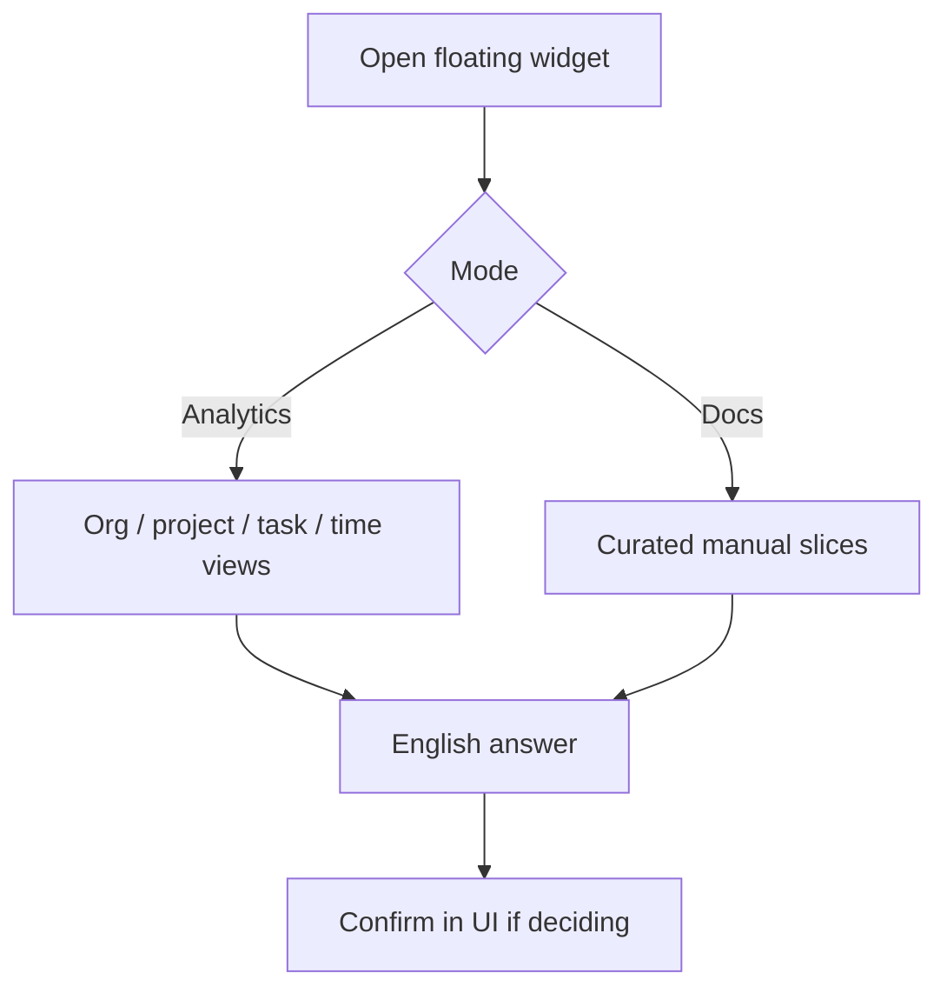

# AI assistant — widget usage — complete guide

**Audience:** End user, Manager  
**Access:** Floating AI widget on supported authenticated pages  
**Requires:** `aiAssistantEnabled` + provider configured (Administration → System Settings → AI)  
**When disabled / missing:** Floating widget absent — ask an admin; not a personal permission named “CanUseAI”.

Ask natural-language questions about your delivery data (Analytics) or product documentation (Docs). Verify important numbers in the UI before acting.

## 1 — Open and pick a mode

1. Sign in as an internal user on a supported page.
2. Open the floating **AI** widget.
3. Choose a mode:

| Mode | Behaviour |
|------|-----------|
| **Analytics** | Answers from AI backend views (tasks, allocations, time, members, etc.) |
| **Docs** | Answers from curated in-app documentation sections matched by keywords |

4. Ask a clear question. Answers are **English** by policy.
5. For budget-sensitive prompts, expect omissions if you lack `CanViewBudgetInfo`.

> **SCREENSHOT** — Capture widget with mode toggle and a sample answer.
> File to add: `media/docs-ai-widget.png`

## 2 — Good question patterns

| Goal | Example prompt style |
|------|----------------------|
| Workload | “Which of my tasks are overdue this week?” |
| Planning | “How does Planning split parallel vs sequential?” (Docs mode) |
| Time | “Summarize hours logged on project X this month.” |
| Release | “What should I check before a release PDF?” (Docs mode) |

Prefer named projects/tasks over vague “everything”.

## 3 — What the widget is not

- Not a substitute for Approvals or permissions.
- Not a write tool — it does not create tasks or change statuses for you.
- Not available to customer portal users as an internal analytics surface (portal scope stays constrained).
- Not controlled by inventing extra Features flags beyond `aiAssistantEnabled`.

## Tips and mistakes

- If Docs mode misses: rephrase with module keywords (Planning, Tickets, Redis, …).
- If Analytics looks empty: check org switcher scope and your report visibility.
- Double-check SLA or budget figures in the native modules before customer communication.

## Done when

- You can switch modes and get a relevant answer without errors.
- You know when to ignore budget omissions as permission-correct.

## Related

- [[08-ai-assistant/admin-configuration]]
- [[08-ai-assistant/troubleshooting]]
- [[03-modules/reporting]]
- [[05-reference/permissions-matrix]]
