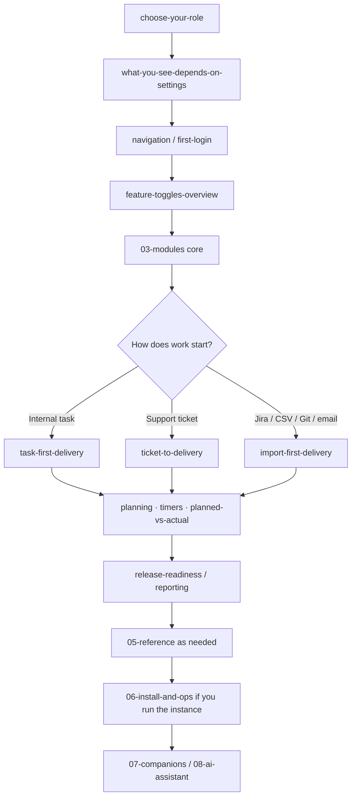
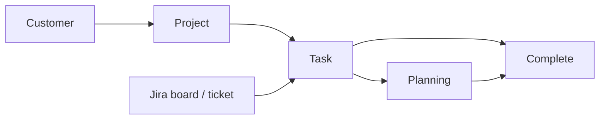

# Myelin manual (Synapse vault)

**Manual version:** 1.3.0  
**Date:** 2026-10-09  
**Language:** English

This vault is the end-user and operator guide for **Myelin**. Import the ZIP into a Synapse vault, then replace screenshot placeholders under `media/` with real PNGs.

Core how-tos include **Mermaid** diagrams (`mermaid` fenced code blocks). Synapse renders them in the note body after import.

## Accuracy note

Feature flags are **only** the switches under Administration → System Settings → Features / AI (and Outlook calendar enable). Planning, Timesheet, Call Records, and Work Summary are **not** toggled there — they use permissions (or are always in the shell for eligible users). See [[01-getting-started/what-you-see-depends-on-settings]] and [[02-settings/feature-toggles-overview]].

Truth sources for this vault: `docs/FEATURES.md`, `docs/ROLE_PERMISSIONS.md`, `README.md`, `Dockerfile`, `docker-compose.yml`.

## Suggested reading order



### Path A — New internal user (1–2 hours)

1. [[01-getting-started/choose-your-role]]
2. [[01-getting-started/what-you-see-depends-on-settings]]
3. [[01-getting-started/first-login]] → [[01-getting-started/navigation]] → [[01-getting-started/global-search]]
4. [[03-modules/dashboard]]
5. [[03-modules/projects-and-tasks]] (plus create-* notes if present)
6. [[04-workflows/task-first-delivery]]
7. [[03-modules/timesheet-and-timers]] + [[04-workflows/timer-context-switch]]
8. [[05-reference/best-practices]]

### Path B — Manager / planner

1. Path A through Dashboard
2. [[03-modules/planning]]
3. [[04-workflows/planned-vs-actual]]
4. [[03-modules/approvals]] · [[03-modules/reporting]]
5. [[04-workflows/release-readiness]]
6. [[05-reference/permissions-matrix]]

### Path C — Support / tickets

1. Path A orientation
2. [[02-settings/feature-toggles-overview]] (`internalTicketsEnabled`)
3. [[03-modules/tickets]] · [[03-modules/customers-and-portal]]
4. [[04-workflows/ticket-to-delivery]]
5. Optional Jira: [[04-workflows/jira-sync]] · [[03-modules/jira-boards-and-tickets]]

### Path D — Integrations / import-heavy teams

1. [[03-modules/integrations]]
2. [[04-workflows/import-first-delivery]]
3. [[04-workflows/jira-sync]] · [[04-workflows/email-to-task]]
4. [[07-companions/ide-extensions]] · [[07-companions/tampermonkey]]

### Path E — Operator (install & run)

1. [[06-install-and-ops/environment-variables]]
2. [[06-install-and-ops/docker-and-health]] **or** [[06-install-and-ops/local-development]]
3. [[06-install-and-ops/install-wizard]]
4. [[06-install-and-ops/deploy-checklist]]
5. Optional: [[06-install-and-ops/redis]] · [[06-install-and-ops/sso-for-companions]] · [[06-install-and-ops/schema]]
6. [[02-settings/feature-toggles-overview]] → [[08-ai-assistant/admin-configuration]]

### Path F — AI assistant

1. [[08-ai-assistant/admin-configuration]]
2. [[08-ai-assistant/widget-usage]]
3. [[08-ai-assistant/troubleshooting]]

## Core how-tos (most used)



| Topic | Note |
|-------|------|
| Create customer | [[03-modules/create-customer]] |
| Create project | [[03-modules/create-project]] |
| Task create → complete | [[03-modules/create-and-complete-task]] |
| Jira boards & tickets | [[03-modules/jira-boards-and-tickets]] |
| Planning (split, multi-alloc, replan) | [[03-modules/planning]] |
| Task-first playbook | [[04-workflows/task-first-delivery]] |
| Ticket → delivery | [[04-workflows/ticket-to-delivery]] |
| Import-first playbook | [[04-workflows/import-first-delivery]] |

## Vault map

| Section | For |
|---------|-----|
| [[01-getting-started/navigation]] | First login and UI orientation |
| [[02-settings/profile]] | Profile, prefs, org settings |
| [[02-settings/feature-toggles-overview]] | Real System Settings feature flags |
| [[03-modules/projects-and-tasks]] | Day-to-day modules |
| [[04-workflows/task-first-delivery]] | Branched playbooks |
| [[05-reference/glossary]] | Glossary, permissions, FAQ, exports |
| [[06-install-and-ops/install-wizard]] | Install, Docker, env, deploy, Redis, schema |
| [[07-companions/desktop-app]] | Desktop, IDE Kanban, Tampermonkey |
| [[08-ai-assistant/admin-configuration]] | AI admin + widget |

## Workflow index

| Workflow | Note |
|----------|------|
| Task-first delivery | [[04-workflows/task-first-delivery]] |
| Ticket to delivery | [[04-workflows/ticket-to-delivery]] |
| Import-first delivery | [[04-workflows/import-first-delivery]] |
| Planned vs actual | [[04-workflows/planned-vs-actual]] |
| Release readiness | [[04-workflows/release-readiness]] |
| Timer context switch | [[04-workflows/timer-context-switch]] |
| Global project governance | [[04-workflows/global-project-governance]] |
| Jira sync | [[04-workflows/jira-sync]] |
| Email to task | [[04-workflows/email-to-task]] |

## Rebuild the ZIP after adding screenshots

```bash
./scripts/pack-synapse-myelin-docs.sh
```

Import `docs/synapse-myelin-manual.zip` into Synapse (**Import ZIP**). Max size 20 MB.


> **SCREENSHOT** — Optional: capture Synapse vault tree after import, or Myelin /docs page.
> File to add: `media/docs-manual-hub.png`
